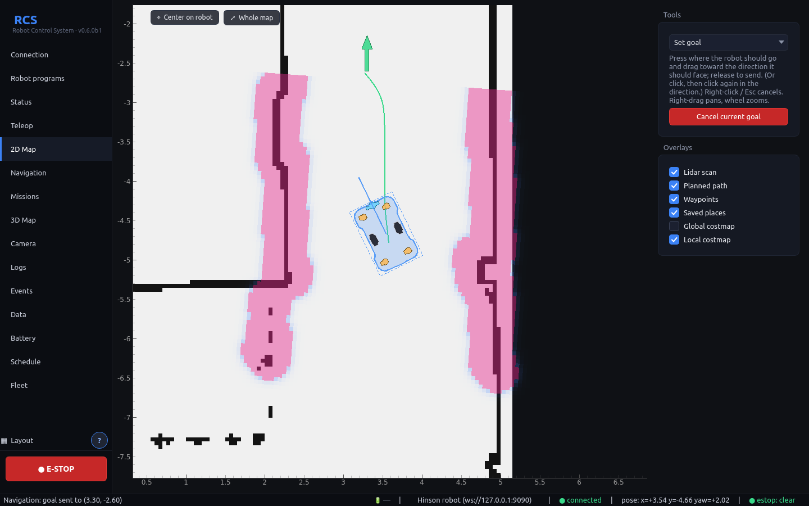
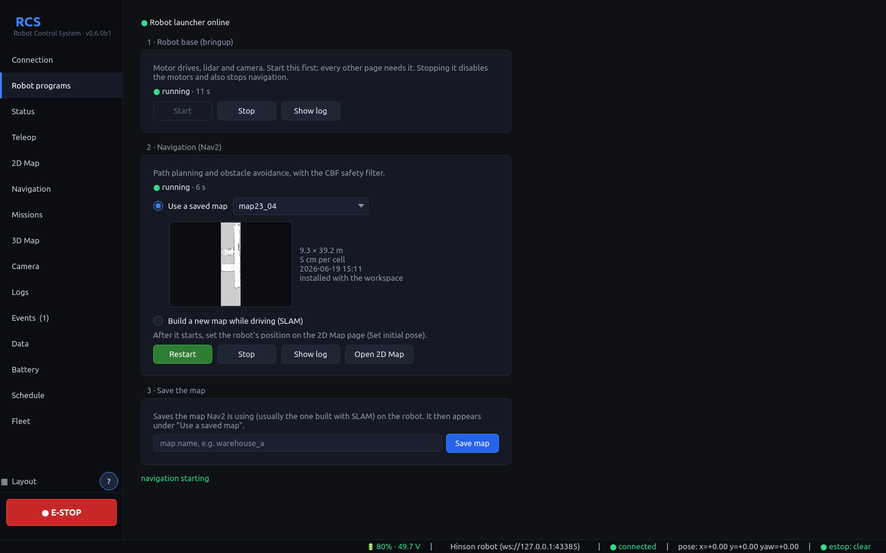
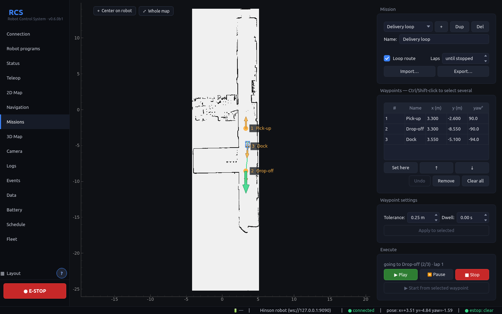
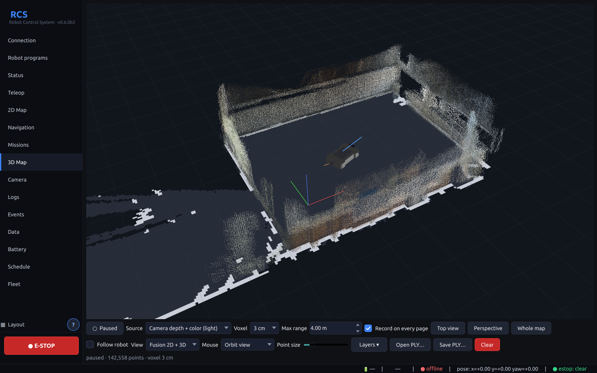
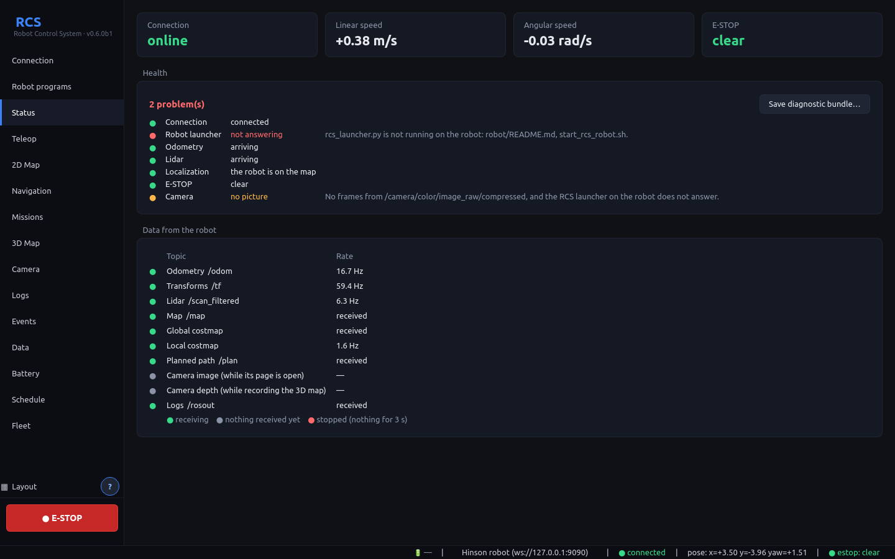
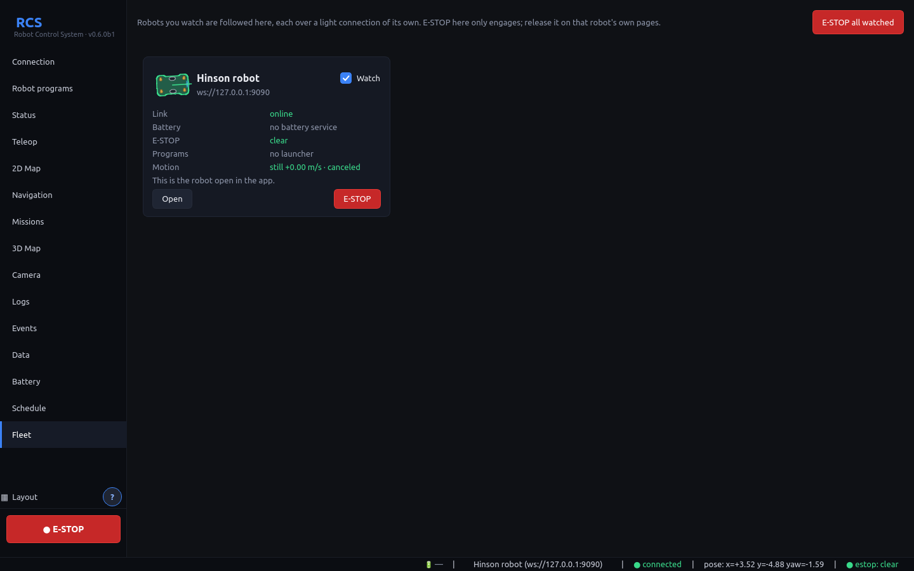
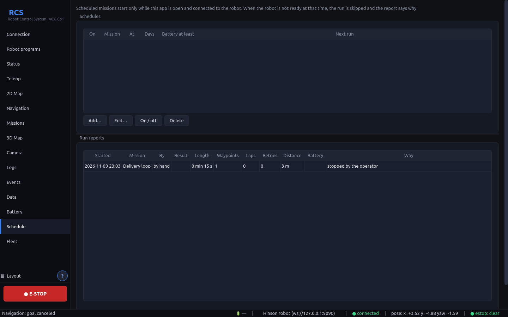

# RCS — Robot Control System

Desktop operator console for Hinson-class differential-drive AMRs. Runs on
**Windows and Linux** as a self-contained app: **no ROS 2 and no Python
needed on the operator PC**.

The robot runs `rosbridge_server` (port 9090); the app connects to it over
WebSocket.

**→ [Download](https://github.com/Tbm615/AMR-RCS/releases/latest)**
&nbsp;·&nbsp; **→ [User guide](docs/USER_GUIDE.md)**



<table>
<tr>
<td width="33%"><a href="docs/screenshots/robot.png"></a><br><sub>Start bringup and Nav2 from the app</sub></td>
<td width="33%"><a href="docs/screenshots/mission.png"></a><br><sub>Looping missions</sub></td>
<td width="33%"><a href="docs/screenshots/map3d.png"></a><br><sub>3D map with the robot's own model</sub></td>
</tr>
<tr>
<td><a href="docs/screenshots/status.png"></a><br><sub>Robot health at a glance</sub></td>
<td><a href="docs/screenshots/fleet.png"></a><br><sub>Fleet: every robot, E-STOP all</sub></td>
<td><a href="docs/screenshots/schedule.png"></a><br><sub>Schedules, statistics, PDF reports</sub></td>
</tr>
</table>

## Features

- **Robots:** profiles with address, topic and frame names and speed limits;
  auto-reconnect.
- **Robot programs:** start and stop bringup and Nav2 on the robot from the
  app, on a saved map or building a new one with SLAM; save maps. No
  terminal on the robot.
- **Teleop:** on-screen joystick or keyboard (W/A/S/D, arrows), with speed
  limits. Publishes only while you drive, so it never blocks Nav2.
- **Sign-in and roles:** with the robot's gateway, every app signs in; viewers
  watch, operators drive, admins manage users. The robot enforces it and keeps
  an audit log of who did what. Optional `wss://` with certificate pinning.
- **E-STOP held by the robot:** every velocity command passes the robot's own
  gate, which latches the E-STOP (through restarts), cancels Nav2, and stops
  the robot by itself if the app driving it goes silent for 3 s
  ([limits](#safety-notes)).
- **2D map:** occupancy grid, lidar points (aligned through `/tf_static`),
  robot footprint, planned path, global/local costmaps. Press and drag an
  arrow (like RViz's 2D Goal Pose) to send a goal with its heading, set the
  initial pose, or add waypoints.
- **Keepout and speed zones:** draw them on the map; the robot keeps them with
  the map and Nav2 obeys them (costmap filters): no path into a keepout zone,
  at most the set % in a slow zone. Saved changes apply at once.
- **Navigation:** live Nav2 state (pending, navigating, reached, canceled,
  aborted, no response), distance and time remaining, cancel.
- **Missions:** ordered waypoints (checkpoints) with tolerance and dwell,
  loop routes, play / pause / stop; automatic retry when Nav2 drops or
  aborts a goal.
- **Schedule:** missions that start by themselves at set times and days, if
  the robot is ready (battery, navigation, E-STOP); a report of every run.
- **3D map:** a colored 3D map built live from the camera's depth + color
  images, each frame placed with the TF at its own timestamp; save / open
  PLY (also opens `save_run`'s `cloud3d.ply`).
- **Your data, per robot:** each robot keeps its own missions, places, event
  log and the state the app was left in. Back it all up to one file, or share
  missions, places and maps with other operators. Copy maps between the PC and
  the robot.
- **Each robot drawn as it is:** the Hinson AMR's CAD model (drive wheels in
  their wells) on the 3D Map, seen from above on the 2D maps and on its Fleet
  card. Another robot gets its own model, imported from its URDF (meshes STL,
  OBJ, DAE) or a mesh, kept with its data and shared in its packs.
- **Battery:** the robot stays connected to its JK-BMS over Bluetooth, so charge,
  each cell and temperatures can be watched from anywhere on the network. The
  robot logs everything the BMS reports every second, a file per boot, kept
  until you delete it: charts per boot and over many boots, and how each boot
  ended (shut down, or a power cut).
- **Fleet:** watch several robots on one screen, each drawn facing the way it
  faces and coloured by its state, with an E-STOP for all.
- **Going to charge by itself:** below a set charge the mission pauses, the
  robot drives to its charging place, and the mission goes on once charged.
- **Remote alerts:** Telegram or e-mail when something goes wrong.
- **Statistics:** missions, success rate, distance, incidents over a period,
  saved as a PDF report.
- **Vietnamese or English**, a **?** button explaining the page on screen, and
  installers for Windows and Ubuntu.
- **Health and support:** the Status page says what is wrong with the robot and
  what to do; one click saves a diagnostic bundle (no secrets in it); crash
  reports; a notice when a new release is out.
- **Camera** (compressed JPEG), received only while its page is open to save
  Wi-Fi, **Status** (speeds, per-topic rates) and **Logs** (`/rosout`).
- Stays responsive on Windows: connecting never blocks the window, heavy
  messages are decoded off the GUI thread, and it reconnects by itself after
  a Wi-Fi drop.

Screenshots are in [`docs/screenshots/`](docs/screenshots/) and throughout the
[user guide](docs/USER_GUIDE.md). They are taken from the app driving real Nav2
on a simulated robot; the 3D map is one the real robot recorded.

## Run from source (developer)

```bash
cd RCS
python -m venv .venv
# linux: source .venv/bin/activate   # windows: .venv\Scripts\activate
pip install -r requirements.txt
python -m rcs
```

## Testing without the robot

| Test | What it needs | What it checks |
|---|---|---|
| `tests/test_features.py` | nothing | map/scan/path rendering, goal/pose/waypoint arrows (press-drag-release), PointCloud2 and JPEG decoding, TF chains, mission executor incl. retries (46 checks) |
| `tests/test_e2e.py` | nothing (built-in mock rosbridge) | the app connects, subscribes, streams teleop, publishes goals |
| `tests/test_robot_page.py` | nothing (mock rosbridge with a fake launcher) | Robot programs page: start/stop bringup and Nav2, SLAM, save map (22 checks) |
| `tests/test_stress.py` | nothing (mock rosbridge `--heavy`: 1000×1000 map and costmap, 4995-point scans, synthetic RGB-D camera with 0.3 s latency) | GUI never stalls > 0.5 s; 3D map walls land within cm of the true walls while the robot turns, colors right; PLY save/open; reconnect after rosbridge dies; unreachable host does not block (24 checks) |
| `tests/test_data.py` | nothing (mock rosbridge running the robot's real `map_exchange.py`) | per-robot data, moving from older versions, what comes back after a crash and that nothing moves by itself, packs, hostile packs, copying maps with lost messages |
| `tests/test_real_launcher.py` | ROS 2 Humble and rosbridge on the PC | the same map copies through the real `rcs_launcher.py` and real rosbridge, in a temporary workspace |
| `tests/test_camera_status.py` | nothing | saying why there is no picture, 3D map before a map frame exists, static transforms asked for again |
| `tests/test_battery.py` | nothing (fake Bluetooth backend) | JK-BMS frames (all fields, checked on a real frame), lost pieces, frames that do not add up, staying connected through dropouts and silence with no scan, read commands only, the battery log (a row a second on the disk, power cuts, kept for good, fetched and deleted by name only), watchdog, History and Battery pages |
| `tests/test_estop.py` | nothing (mock rosbridge running the real `estop_gate.py`) | E-STOP latched on the robot and through restarts, the app losing its link while driving, released only on purpose |
| `tests/test_estop_ros.py` | ROS 2 Humble on the PC | the real `rcs_safety.py` node: nothing passes while engaged or while it is down, Nav2 cancelled, stop after a lost heartbeat, bringup refused without it |
| `tests/test_schedule.py` | nothing | schedule times, skipped runs and why, run reports through the real mission executor |
| `tests/test_fleet.py` | nothing (two mock robots) | the Fleet page, battery per robot, E-STOP all, offline robots |
| `tests/test_gateway.py` | nothing (the real gateway in front of a mock rosbridge) | users, passwords, tokens, the rules per role, refusals, the audit log, guessing locked out, wss://, and the app through it: sign-in, greyed-out controls, a new role or a sign-out while connected, users and audit for admins |
| `tests/test_updates.py` | nothing (GitHub's answer made up) | versions, a robot side older or newer than the app, the new-release notice and its daily limit |
| `tests/test_diagnostics.py` | nothing | health checks, the diagnostic bundle (no tokens or passwords in it), crash reports, an app that did not close properly |
| `tests/test_alerts.py` | nothing (Telegram and mail faked) | which events go out, not too often, failures noted without looping, no bot token in bundles |
| `tests/test_charging.py` | nothing (battery and Nav2 made up) | going to charge below the set charge, the mission paused and resumed, retries, E-STOP, the operator taking over |
| `tests/test_i18n.py` | nothing | the app in Vietnamese: every page builds, texts translated, patterns for texts with numbers, rich text |
| `tests/test_stats.py` | nothing | statistics from the run reports and events, the report, the PDF |
| `tests/test_help.py` | nothing | the ? button: a guide for every page, in English and Vietnamese |
| `tests/test_robot_model.py` | nothing (URDF, STL, OBJ, DAE written by the test) | the Hinson's drive wheels in their wells (and the workspace URDF, if there), URDF import, files from anyone, the 2D shape and Fleet icon, a model per robot, packs, another robot selected while connected |
| `tests/test_built_binary_e2e.py` | a build in `dist/` | the packaged binary does the same |
| `tests/test_sim_nav2.py` | ROS 2 Humble on the PC, `sim/run_sim.sh` running | the app drives **real Nav2** through **real rosbridge** (28 checks) |
| `tests/test_gazebo.py` | ROS 2 Humble and Gazebo 11, run by `sim/gazebo/run_gazebo.sh --test` | the whole robot side in Gazebo against the truth: Robot programs, teleop, turning on the spot about the robot's centre, clearance, goals, E-STOP, the robot stopping itself when the app is lost, missions, camera and 3D map, SLAM |

v0.2.2 was also tested on the real robot over Wi-Fi: live map from
slam_toolbox, costmaps, camera, point cloud, goals with heading, cancel,
E-STOP while driving (stopped in 0.55 s), a looping two-waypoint mission
(4 legs) and teleop.

All tests run headless with `QT_QPA_PLATFORM=offscreen`. With the sim running,
`tests/screenshot_live.py` regenerates the screenshots in `docs/screenshots/`;
`tests/screenshot_extra.py` takes the Robot programs and 3D Map ones (against
the mock robot and a saved 3D map, see its header).

### Simulated robot with real Nav2 (`sim/`)

`sim/run_sim.sh` starts, on an isolated ROS domain (77, loopback only):
`rosbridge_server` on port 9090, this workspace's
`navigation/robot_navigation.launch.py` (AMCL, SmacPlanner2D + MPPI, CBF
filter) on `maps/map23_04.yaml`, and `sim/fake_base.py`, a kinematic stand-in
for the drive and lidar (odom, TF, `/scan_filtered` ray-cast on the map).
`sim/stop_sim.sh` stops it all. Point RCS at `127.0.0.1:9090` to use it
interactively, or run `tests/test_sim_nav2.py`, which covers: localizing from
the app, scan-to-map alignment through `/tf_static`, goal from the map panel,
cancel, E-stop while driving, and a looping mission.

If `rosbridge_suite` is not installed via apt, build it into a separate
workspace and pass it as `BRIDGE_WS=/path/to/ws`.

### Virtual robot in Gazebo (`sim/gazebo/`)

`sim/gazebo/run_gazebo.sh` puts the Hinson model (the robot's own URDF, through
`make_urdf.py`) in Gazebo 11 on the walls of a saved map or a test building,
with the real rosbridge, `rcs_launcher.py`, the robot's E-STOP gate, scan
filter, Nav2 and CBF filter, then opens RViz and the app already connected.
Start bringup and Nav2 from the Robot programs page as on the robot.
`--test` runs `tests/test_gazebo.py`; `--headless` has no Gazebo window; `--help`
lists the rest. It runs on ROS domain 77, loopback only, away from the real
robot, and keeps the app's settings in `/tmp/rcs_gazebo/app`.

## Build standalone executable

**Important:** build inside a clean virtualenv — PyInstaller otherwise bundles
every library it finds in your user site-packages (CUDA/Torch/etc.) and the
artifact balloons to multiple gigabytes. The project's `.venv` is fine:

```bash
python -m venv .venv
source .venv/bin/activate   # or: .venv\Scripts\activate on Windows
pip install -r requirements.txt pyinstaller
python build.py             # builds dist/rcs/ (linux) or dist/rcs\ (windows)
```

Default build is `--onedir` (a folder you ship). Set `RCS_ONEFILE=1` to try
`--onefile`; this can fail on some binutils versions with an objcopy error —
fall back to `--onedir` if so.

### Cross-platform packaging via GitHub Actions

`.github/workflows/build.yml` runs on every push, on a real Linux and a
real Windows machine: feature tests, the source E2E test, then builds the
app and runs the built binary against the mock rosbridge. On Windows it
builds and tests both the console and the windowed (no console) variants.
Download the archives from the run's Artifacts section on the Actions tab.

## Robot side

The robot runs `rosbridge_server` and the small **RCS launcher**
([`robot/`](robot/)), both started at boot by a crontab entry, with the
robot's own E-STOP gate, the battery service and, once there are users, the
sign-in gateway. Copy the release's `robot/` folder to the robot and run
`bash install_robot.sh` (it checks what is missing, sets the boot entry and
starts it all; `--dry-run` first to see). After that the operator powers on
the robot and starts bringup and Nav2 from the app. Details:
[`robot/README.md`](robot/README.md).

## Safety notes

- The **E-STOP is software, held on the robot** by `robot/rcs_safety.py`:
  the drives follow only what it lets through, so once engaged no publisher
  (Nav2, gamepad, another app) can move the robot until an operator releases
  it. If it is not running, nothing reaches the drives. Bringup started by
  hand on the robot, not from the app, is not guarded. Keep the hardware
  E-stop within reach.
- Teleop only publishes while you are driving (plus 0.3 s of zero commands
  when you let go), so it never blocks Nav2.
- Teleop goes to `/cmd_vel_safe` and bypasses the CBF filter, like the
  gamepad and the web console.
