# RCS User Guide

RCS (Robot Control System) is a desktop app for operating Hinson-class
differential-drive AMRs: drive them by hand, see the map, lidar and camera,
send navigation goals and run waypoint missions.

It runs on **Windows 10/11** and **Linux (x86-64)**. The operator PC does
**not** need ROS 2 or Python. The app talks to the robot over the network
through `rosbridge_server`, which runs on the robot.

- [1. How it fits together](#1-how-it-fits-together)
- [2. Prepare the robot (one time)](#2-prepare-the-robot-one-time)
- [3. Install the app](#3-install-the-app)
- [4. First connection](#4-first-connection)
- [5. The main window](#5-the-main-window)
- [6. Robot programs: start bringup and Nav2](#6-robot-programs-start-bringup-and-nav2)
- [7. Driving by hand (Teleop)](#7-driving-by-hand-teleop)
- [8. E-STOP](#8-e-stop)
- [9. Map, localization and goals (2D Map)](#9-map-localization-and-goals-2d-map)
- [10. Navigation page](#10-navigation-page)
- [11. Missions, checkpoints and loop routes](#11-missions-checkpoints-and-loop-routes)
- [12. Status, Camera, 3D Map, Logs and Events](#12-status-camera-3d-map-logs-and-events)
- [13. Schedule: missions at set times](#13-schedule-missions-at-set-times)
- [14. Several robots](#14-several-robots)
- [15. Back up, share and copy maps (Data page)](#15-back-up-share-and-copy-maps-data-page)
- [16. Settings files and advanced options](#16-settings-files-and-advanced-options)
- [17. Troubleshooting](#17-troubleshooting)

---

## 1. How it fits together

```
 Operator PC (Windows / Linux)                Robot PC (ROS 2 Humble)
 ┌──────────────────────────┐   WebSocket    ┌──────────────────────────────┐
 │ RCS app                  │ ─────────────▶ │ rosbridge_server :9090       │
 │ (no ROS 2 installed)     │ ◀───────────── │   ↕ ROS 2 topics / actions   │
 └──────────────────────────┘   port 9090    │ bringup, Nav2, AMCL, camera… │
                                             └──────────────────────────────┘
```

What the app uses on the robot (defaults, all changeable per robot):

| Purpose | Topic / frame |
|---|---|
| Teleop and E-STOP velocity | `/cmd_vel_safe` (geometry_msgs/Twist) |
| Robot speed | `/odom` |
| Lidar | `/scan_filtered` |
| Map | `/map` |
| Costmaps | `/global_costmap/costmap`, `/local_costmap/costmap` |
| Planned path | `/plan` |
| Goals | `/goal_pose` (PoseStamped), `/navigate_to_pose/_action/status` |
| Initial pose | `/initialpose` |
| Camera | `/camera/color/image_raw/compressed` |
| Point cloud | `/camera/depth/points` |
| Robot logs | `/rosout` |
| E-STOP flag | `/amr/estop` (std_msgs/Bool) |
| Frames | `map`, `odom`, `base_link`, `laser_frame` (from `/tf` and `/tf_static`) |

---

## 2. Prepare the robot (one time)

The robot needs two things for RCS: `rosbridge_server` (the app connects to
it) and the **RCS launcher** (lets the app start and stop bringup and Nav2,
see [section 6](#6-robot-programs-start-bringup-and-nav2)). Both are in the
[`robot/`](../robot/) folder of this repository and start by themselves every
time the robot boots.

On the robot PC, once:

```bash
sudo apt install ros-humble-rosbridge-suite ros-humble-compressed-image-transport \
    ros-humble-compressed-depth-image-transport
# copy the robot/ folder of this repository next to the workspace, e.g.:
mkdir -p ~/tbm_test/rcs_robot && cp robot/* ~/tbm_test/rcs_robot/
chmod +x ~/tbm_test/rcs_robot/*
# start both at every boot (user crontab, no sudo needed):
(crontab -l 2>/dev/null; echo "@reboot sleep 10 && $HOME/tbm_test/rcs_robot/start_rcs_robot.sh") | crontab -
# start them now without rebooting:
nohup setsid ~/tbm_test/rcs_robot/start_rcs_robot.sh >/dev/null 2>&1 &
```

`start_rcs_robot.sh` uses the robot's ROS settings (CycloneDDS, domain 0, the
workspace's `cyclonedds.xml`) and restarts rosbridge or the launcher if one of
them exits. If your workspace is not `~/tbm_test`, set `RCS_WS` at the top
of the script. Details, logs and how to remove it:
[`robot/README.md`](../robot/README.md).

Allow TCP port 9090 from the operator network if a firewall is active:

```bash
sudo ufw allow from 192.168.10.0/24 to any port 9090 proto tcp
```

`ros-humble-compressed-image-transport` makes the camera publish
`/camera/color/image_raw/compressed`, which the Camera page shows.
`ros-humble-compressed-depth-image-transport` adds
`/camera/depth/image_raw/compressedDepth`, which the 3D Map page uses to
build the colored 3D map (about 1 MB/s over Wi-Fi, instead of 10 MB/s or more
for the raw point cloud).

After that, everything is done from the app: power on the robot, connect,
and start bringup and Nav2 on the **Robot programs** page.

---

## 3. Install the app

Download the build for your OS from the
[Releases page](https://github.com/Tbm615/AMR-RCS/releases/latest).

**Windows**

1. Download `rcs-windows-x86_64.zip` and unzip it anywhere (for example
   `C:\RCS`).
2. Run `rcs\rcs.exe`. Keep the `_internal` folder next to it.
3. The first time, Windows SmartScreen may warn that the app is from an
   unknown publisher (the build is not code-signed). Click **More info →
   Run anyway**.

`rcs-windows-x86_64-console.zip` is the same app but also opens a console
window with log output. Use it when troubleshooting.

**Linux**

```bash
tar xzf rcs-linux-x86_64.tar.gz
./rcs/rcs
```

On minimal desktop installs Qt may need `libxcb-cursor0`
(`sudo apt install libxcb-cursor0`).

---

## 4. First connection

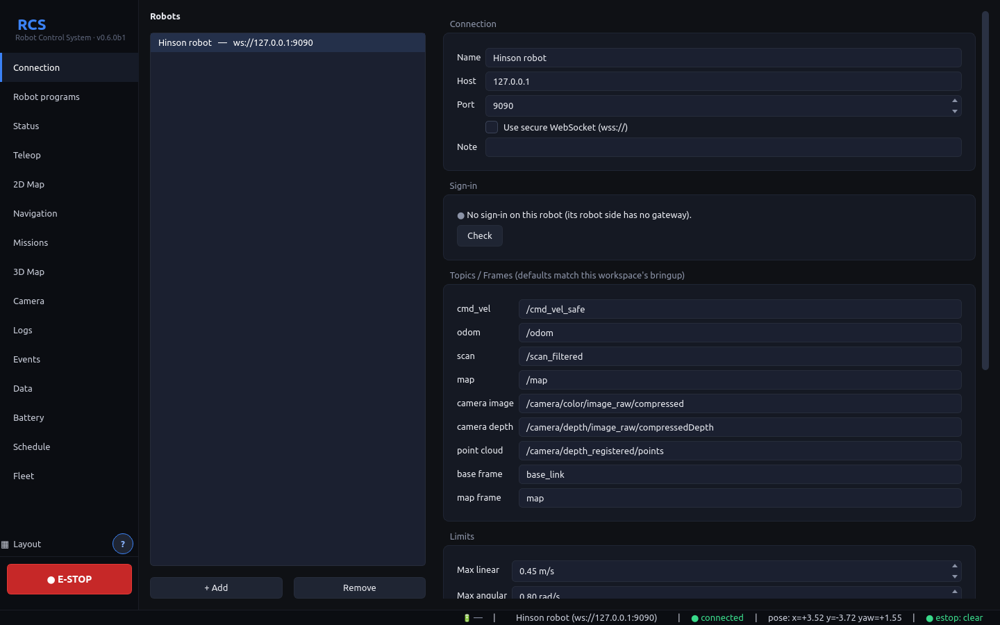

1. Open the **Connection** page (selected when the app starts).
2. A robot named **Hinson robot** already exists. Select it in the
   **Robots** list.
3. Set **Host** to the robot's IP address (for example `192.168.10.10`) and
   **Port** to `9090`. Leave **Use secure WebSocket** off unless you set up
   TLS on rosbridge.
4. Check the topic names under **Topics / Frames**. The defaults match this
   robot's bringup; change them only if your launch files differ.
5. Click **Save changes**, then **Connect**.

### Signing in

A robot whose robot side has the gateway (robot/README.md, *Sign-in and
roles*) asks who you are: **Connect** opens **Sign in** (user and password, given
by an admin). The app keeps what the robot gives back for 30 days, so you sign
in once per PC; the **Sign-in** box on the Connection page shows who you are
and your role, and **Sign out** ends it.

- **viewer**: sees everything and may stop the robot (E-STOP, cancel a goal),
  but not drive: Teleop, mission start and Robot programs are greyed out.
- **operator**: drives, sends goals, runs missions, starts programs, saves and
  sends maps, releases the E-STOP.
- **admin**: also **Users and audit log…**: add users, change roles, set a new
  password, sign someone out everywhere, and read what was done with the robot
  and by whom (filter, export as CSV).

Something your role may not do is not sent, and the status bar says why. The
robot refuses it anyway, whatever app sends it. If an admin signs you out or
changes your password, the app stops and asks you to sign in again; a new role
applies at once.

With **Use secure WebSocket (wss://)**, the first sign-in shows the robot's
certificate fingerprint: compare it with the one printed on the robot. The app
then refuses any other certificate; **Forget certificate** if it was replaced on
purpose. A robot without the gateway needs no sign-in, as before.

### The robot's model and footprint

Lower on the same page, **Robot model** sets how this robot is drawn on the 3D
Map, the 2D maps and its Fleet card, with a preview from above:

- **Automatic** (the default): the Hinson AMR if the footprint is about its
  size, otherwise a box of the footprint.
- **Hinson AMR**: the model that comes with the app, whatever the footprint.
- **A box of the footprint**.
- **Imported model**: click **Import URDF / mesh…** and pick
  - a **URDF** (`.urdf`): its meshes (STL, OBJ or DAE) are found from
    `package://` names in the folders around it, boxes, cylinders and spheres
    are drawn too. A `.xacro` needs ROS 2 on this PC (the `xacro` command);
    otherwise expand it on the robot first: `xacro robot.urdf.xacro > robot.urdf`.
  - one **STL / OBJ / DAE**: the whole robot, its origin taken as base_link,
    millimetres recognised.
  - an **RCS model** (`.npz`) another operator gave you with **Export…**.

  Links named `*wheel*` are drawn as drive wheels, `*caster*` as casters, and
  lidar, camera and other sensors in their own colour. What could not be used
  (a mesh not found) is listed under the preview; the rest is still drawn.
  The model is kept with the robot's data and goes into its backups.

**Footprint** (length × width) is the rectangle the lidar clearance bars on the
Teleop page measure from; it is drawn dashed around the robot on the maps.
**From model** sets it to the smallest rectangle centred on base_link that holds
the whole model. It applies with **Save changes**.

When it works, the text under the buttons turns green
(`connected — ws://…`) and the status bar at the bottom shows
**● connected**. If the robot reboots or Wi-Fi drops, the app keeps
reconnecting every 2 seconds until you click **Disconnect**.

---

Tick **Connect to the last robot when the app starts** on the Connection page
to skip this step next time.

**Language.** **Language / Ngôn ngữ** on the Connection page: English or Tiếng
Việt, applied the next time the app starts. A text not translated yet stays in
English.

**New versions.** With **Tell me when a new version of RCS is out** ticked (the
default), the app asks GitHub once a day for the list of releases (nothing
about your PC is sent) and shows **⬆ RCS vX is out** in the status bar, a link
to the download. A beta is offered newer betas too; a release only releases.

**The robot side's version.** The Robot programs page says when the robot's
`robot/` files are older than this app needs, or newer than the app: copy the
matching release's `robot/` folder over (robot/README.md).

## 5. The main window

- **Sidebar (left):** pages: Connection, Robot programs, Status, Teleop, 2D Map,
  Navigation, Missions, 3D Map, Camera, Logs. The red **● E-STOP** button
  at the bottom is always visible.
- **Status bar (bottom):** active robot and address, connection state,
  robot pose in the map (`x`, `y`, `yaw` in rad), E-STOP state.

**Several pages at once.** A sidebar click shows that page in place of the
one you are using, as before. To see more than one page:

- **Ctrl+click** a sidebar entry: the page opens to the right of the page in
  use (for example drive with Teleop while watching the 2D Map).
- **Right-click** a sidebar entry, or a page's tab: *Show here*, *Open as a
  tab*, *Open beside (right)*, *Open below*, *Open in a new window* (handy
  on a second monitor), *Move back to the main window*, *Close*.
- **▦ Layout** (above E-STOP) sets up the usual combinations in one click:
  *Drive* (Teleop + 2D Map), *Mapping* (2D Map + 3D Map), *Monitor*
  (2D Map + Camera + Status), *Missions* (Missions + Camera), or back to
  *Single page*. **Save this layout…** keeps the current arrangement under a
  name of your own, listed in the same menu.
- Drag the bar between two pages to resize them; drag a tab to reorder it;
  the **×** on a tab closes that page. Closing a page window closes its
  pages. Pages that are open are shown brighter in the sidebar; the one you
  are using is highlighted.
- The layout, including page windows and their position, is kept when you
  close the app and comes back at the next start.
- The 3D Map can be split and tabbed but not opened in its own window yet.
- The round **?** next to **Layout** (or Shift+F1) explains the page on screen,
  in the app's language.

  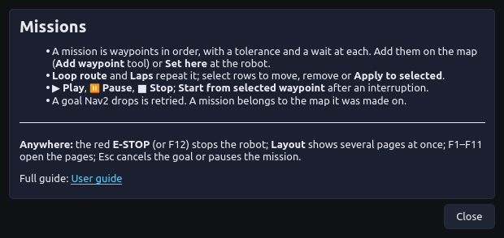

Pages you cannot see (closed, or behind another tab) are not drawn, and the
camera and 3D map only receive data while their page is on screen, so extra
pages cost Wi-Fi only while you look at them.

**Keyboard.**

| Key | Action |
|---|---|
| **F1** … **F11** | open the pages, in the order of the sidebar |
| **Ctrl+1** … **Ctrl+5** | the preset layouts |
| **F12** | engage E-STOP, from any window of the app. It never releases it: click the button for that |
| **Esc** | clear what the mouse is doing on a map (arrow, ruler), otherwise pause the mission or cancel the goal |

All map views share the same controls:

- **Mouse wheel:** zoom. **Right-drag** (or middle-drag): pan.
- **Left press and drag:** set a goal, the initial pose or a waypoint with a
  heading: an arrow follows the mouse and the pose is sent when you release
  (see [section 9](#9-map-localization-and-goals-2d-map)).
- **Center on robot** / **Whole map** buttons (top-left of the map). A new
  map opens fitted; later map updates keep your zoom.
- The map coordinates under the mouse show at the bottom left. On the 2D Map,
  **Measure distance** (in the Tools list) draws a ruler: press and drag
  between two points; Esc clears it.
- The robot seen from above, from its model: body in blue, drive wheels dark,
  casters orange, lidar and camera cyan. Dashed rectangle: its footprint. Blue
  line: its heading. A robot without a model is a blue box.
- Red dots: lidar points. Green line: path planned by Nav2.
- Green arrow: the current Nav2 goal and the heading the robot will have.
- Orange dots and arrows: waypoints of the open mission with their heading,
  labeled with their order and name.
- Costmaps (when enabled): magenta = obstacle, blue haze = inflation around it.

---

## 6. Robot programs: start bringup and Nav2

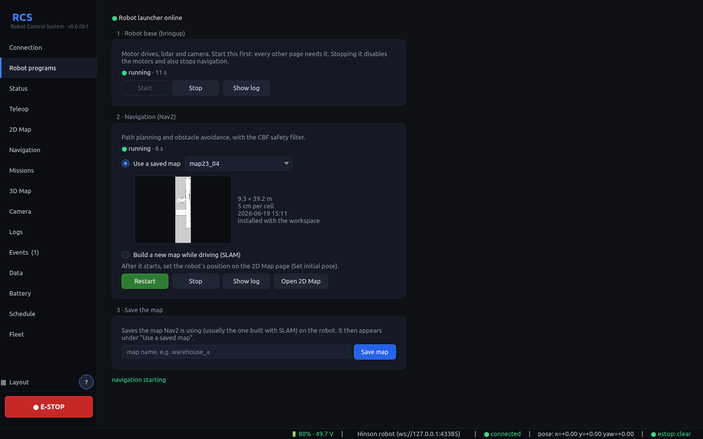

This page starts and stops the ROS programs on the robot, so you do not need
a terminal on the robot. It needs the RCS launcher installed once
([section 2](#2-prepare-the-robot-one-time)); the banner at the top says
**Robot launcher online** when it answers.

**1 · Robot base (bringup).** Motor drives, lidar, scan filter and camera.
Click **Start**; it shows *running* once odometry and the lidar are up
(a few seconds). Every other page needs it. **Stop** disables the motors and
stops navigation too (you are asked to confirm).

**2 · Navigation (Nav2).** Planner, controller and the CBF safety filter.
Choose how the robot knows where it is, then click **Start**:

- **Use a saved map:** pick a map from the list (the workspace's maps and the
  ones you saved). A preview shows under the list with its size, resolution
  and date, so you can check it is the right one; click it to enlarge (wheel
  zooms, drag pans). After it starts, set the robot's position on the 2D Map
  page (**Set initial pose**): **Open 2D Map** takes you there. If the robot
  has not been moved since it last ran on this map, **Use last position**
  (here and on the 2D Map) sets it in one click; check that the lidar
  points fall on the walls afterwards.
- **Build a new map while driving (SLAM):** the map starts empty and grows on
  the 2D Map page as the robot moves (Teleop or goals). No initial pose
  needed; goals work right away inside the mapped area. SLAM adds the lidar to
  the map every 0.5 m driven (slam_toolbox's `minimum_travel_distance`):
  turning on the spot adds nothing, and the lidar sees nothing behind the
  robot, so drive into each part of the area, facing different ways.

While navigation runs, the button reads **Restart**: change the map or the
mode and click it to switch.

**3 · Save the map.** Type a name (letters, digits, `-`, `_`) and click
**Save map**. The map is saved on the robot (`~/tbm_test/maps/`) and appears
under *Use a saved map*, for this and every later session.

Each stack shows its state (stopped, starting…, running, stopping…,
failed) and how long it has been in it. **Show log** shows the last lines of
its output; it opens by itself when a stack fails. Programs started by hand
on the robot (from a terminal) are shown as *running (started outside the
app)* and must be stopped where they were started.

The full logs are on the robot in `~/tbm_test/runlog/rcs_bringup.log` and
`rcs_nav.log`.

---

## 7. Driving by hand (Teleop)

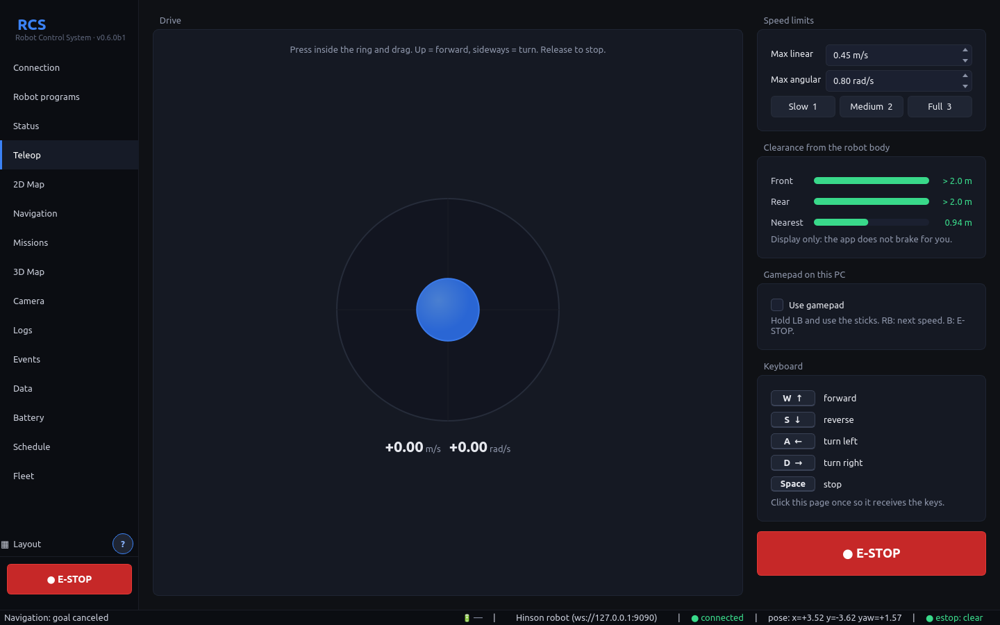

1. Open **Teleop**.
2. Drive with the **joystick**: press inside the ring and drag. Up is
   forward, sideways turns. Release to stop.
3. Or use the **keyboard**, after clicking once on the Teleop page so it
   has focus: **W / ↑** forward, **S / ↓** reverse, **A / ←** turn left,
   **D / →** turn right, **Space** stop.
4. **Speed limits** cap the commands (defaults 0.45 m/s and 0.8 rad/s). The
   live command is shown under the joystick.

Teleop commands go to `/cmd_vel_safe` at 20 Hz while you drive. When you let
go, the app sends zero velocity for 0.3 s and then stops publishing, so it
does not block Nav2. Like the gamepad, teleop bypasses the CBF safety
filter: watch the robot while driving.

**Gamepad.** Plug a gamepad into the PC and tick **Use gamepad** (keep your
hands off it for a second while it calibrates). Hold **LB** and drive with the
left stick (forward, back) and right stick (turn): nothing moves unless LB is
held, so a knocked pad cannot start the robot. **RB** changes the speed step and
**B** engages E-STOP. It works while you look at any page, even with Teleop
closed. If the pad is unplugged the robot stops and the box unticks.

**Speed.** **Slow**, **Medium** and **Full** (or keys **1**, **2**, **3**) drive
at 25 %, 50 % or 100 % of the two limits, for the joystick and the keyboard.

**Clearance.** The bars show the free distance from the robot's body to the
nearest lidar point straight ahead (**Front**), straight behind (**Rear**)
and in any direction (**Nearest**, what matters when turning on the spot):
green, amber under 0.80 m, red under 0.25 m. *no lidar* means no scan arrived
for a second. They are a display only: the app does not brake for you.

---

## 8. E-STOP

Click **● E-STOP** (sidebar or Teleop page). While engaged:

- the current Nav2 goal is canceled and the running mission is stopped,
- the app publishes zero velocity on `/cmd_vel_safe` continuously,
- `/amr/estop` is set to `true` (other consoles listening to it, such as
  the web control center, show it too).

Click the button again to release it. If another console publishes
`/amr/estop`, RCS mirrors that state.

**The robot holds the E-STOP itself** (`rcs_safety.py`, see
`robot/README.md`). Every velocity command, from Nav2, the gamepad or any app,
passes through it on the robot, so:

- once engaged, nothing moves the robot, whatever else publishes, until an
  operator releases it from an app;
- it stays engaged if the app closes, the Wi-Fi drops, or the robot restarts;
- an E-STOP engaged on the robot (by another app, the web console or the
  Fleet page) shows in every app connected to it.

**If the app is lost while it drives the robot** (a mission, a goal it sent,
or teleop) — Wi-Fi gone, PC asleep, app crashed — the robot stops by itself
after 3 s: it cancels the Nav2 goal and holds still for a moment. The app
pauses the mission and says so in Events; resume it once you see the robot
again. An app that only watches never stops the robot.

> **Important:** this is still a *software* stop. Bringup started by hand on
> the robot (not from the Robot programs page) is not guarded. Always keep
> the robot's hardware E-stop within reach.

---

## 9. Map, localization and goals (2D Map)

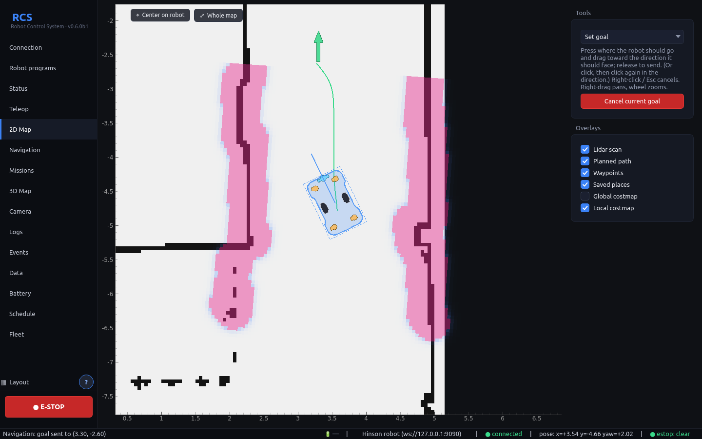

The map appears as soon as the robot publishes `/map` (from SLAM, or from
Nav2's map server).

**Localize the robot (set initial pose).** After Nav2 starts, AMCL needs to
know where the robot is. If the robot rectangle is not where the robot
really is, or the Navigation page reports *no response from Nav2*:

1. In **Tools**, choose **Set initial pose**.
2. Press the left button on the map where the robot is, drag toward the
   direction the robot is facing (a violet arrow follows the mouse), and
   release.

The lidar points should then line up with the walls on the map.

**Send a goal.**

1. In **Tools**, choose **Set goal** (the default).
2. Press the left button on the destination and drag toward the direction
   the robot should face when it arrives, like the *2D Goal Pose* tool in
   RViz. An orange arrow follows the mouse; release to send the goal. The
   goal then stays on the map as a green arrow until it is reached or
   canceled.
3. Watch progress on the **Navigation** page (you can send goals the same
   way there).

If dragging is awkward (touchpad), click once on the destination: the arrow
then follows the mouse, and a second click sends it. Right-click or **Esc**
cancels a goal you are still aiming.

**Cancel current goal** stops the robot's navigation.

**Add waypoint** mode: press and drag the same way to add a waypoint, with
its heading, to the mission currently open on the **Missions** page.

**Overlays** turn on or off the lidar points, the planned path, the
waypoints, the zones, and the global and local costmaps (shown in red/blue
over the map).

**Nav2 starts without an initial pose.** When the app starts Nav2 on a saved
map (Robot programs page), set the robot's position as above or press **Use
last position**; the Status page says *not on the map yet* until you do.
(Earlier versions let the robot's launch file set (0, 0) a few seconds after
the start, which could overwrite the pose you had just set.)

Once the pose is set, the Status page also says how sure AMCL is: *on the map,
but unsure (±0.40 m, ±18°)* when its spread is over 0.30 m or 12°. The drawn
robot can then be off by a few tens of centimetres and degrees. Drive a little
(AMCL updates after about 0.25 m or 0.2 rad) or set the pose again; if it stays
unsure, the map is probably out of date (furniture moved): build it again.

### Keepout and speed zones

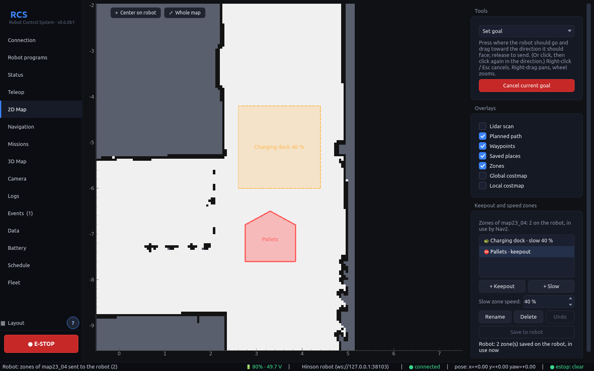

Zones belong to a saved map and are kept on the robot, next to the map. Every
PC that connects sees the same ones. They are for the map Nav2 runs on, so
start Nav2 on a saved map first.

- **Keepout** (red): Nav2 never plans a path into it, and the app refuses a
  goal or a saved place inside one. Use it for stairs, a loading bay, a
  fragile area.
- **Slow** (amber, dashed): Nav2 drives at most the percentage you set (10 to
  90 % of its usual top speed) while the robot is inside. Where two slow zones
  overlap, the lower one counts.

To draw one, press **+ Keepout** or **+ Slow** (set the % next to it first).
Then click the corners on the map. **Double-click**, **Enter** or a click on
the first corner closes the zone. **Right-click** or **Backspace** takes the
last corner back, and **Esc** drops the zone. Select a zone in the list to
see it highlighted, change a slow zone's %, **Rename** (or double-click it)
or **Delete** it.

Changes stay on this PC until you press **Save to robot**. If Nav2 is running
on that map, it uses them at once, without a restart (*in use by Nav2*).
**Undo changes** goes back to what the robot has. Viewers can see zones but
not change them, and each change is in the robot's audit log.

Zones stop Nav2 only: you can still drive anywhere by hand, for example to
get the robot out of a keepout zone. While you drive, the **Teleop** page
says when the robot is inside or near a zone. A mission waypoint inside a
keepout zone is not refused, but the mission stops there because Nav2
cannot reach it; the app warns when you add one.

---

## 10. Navigation page

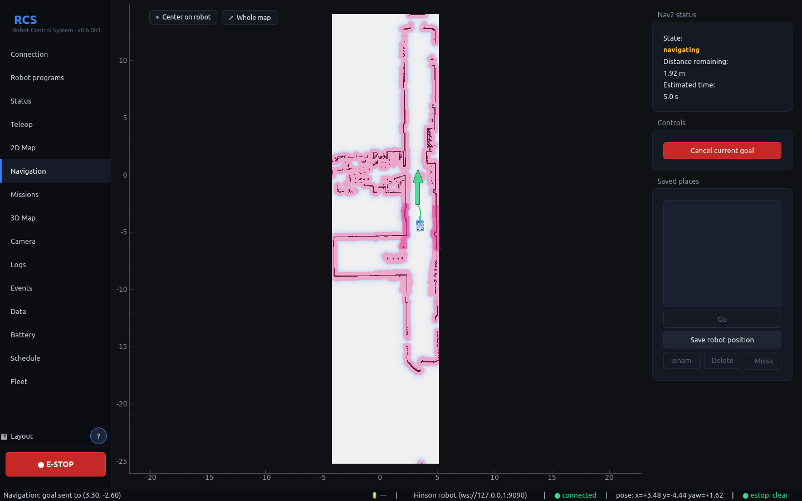

The same map with both costmaps shown, plus the **Nav2 status**:

| State | Meaning |
|---|---|
| goal sent, waiting for Nav2… | the goal was published, Nav2 has not picked it up yet |
| navigating | Nav2 accepted the goal and is driving |
| goal reached | done |
| canceled | canceled by you, the E-STOP, or a mission stop |
| aborted by Nav2 | Nav2 gave up (no path, robot stuck…) |
| no response from Nav2 | nothing happened within 4 s: Nav2 is not running, or the robot is not localized (set the initial pose) |

**Distance remaining** is measured along Nav2's planned path from the
robot's position. **Estimated time** divides it by the robot's current speed
(or the speed limit while the robot is standing still). You can send goals
and cancel from this page too.

**Saved places.** Name the spots you use often, like the charger. Drive the
robot there and click **Save robot position**. Select a place and click
**Go** (or double-click it) to send the robot there; **→ Mission** adds it to
the open mission as a waypoint. Places show as teal diamonds on the maps
(*Saved places* in the 2D Map overlays). A place belongs to the saved map it
was stored on and only shows on that map.

---

## 11. Missions, checkpoints and loop routes

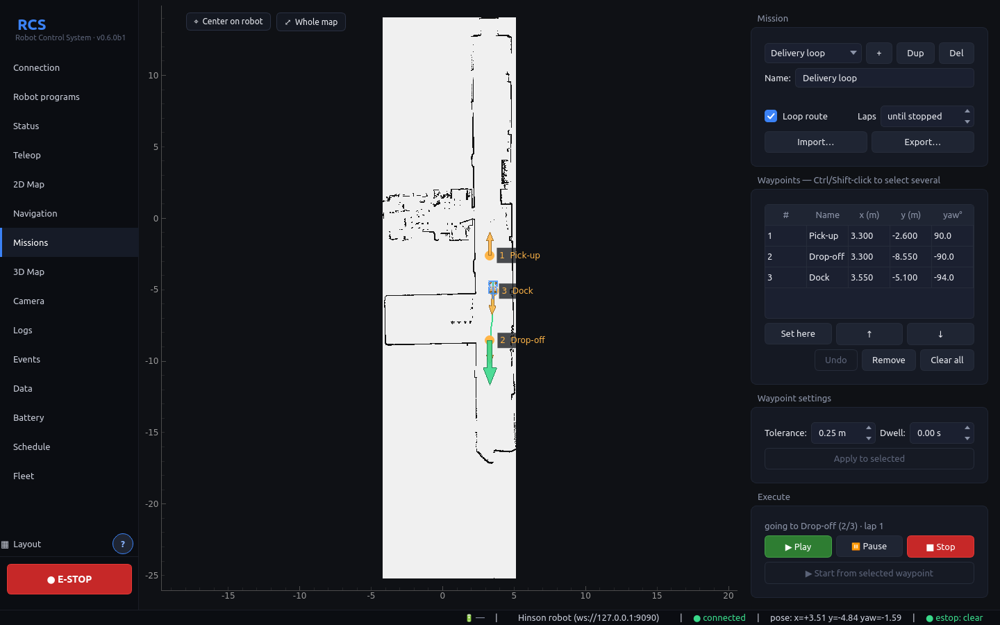

A mission is an ordered list of waypoints (checkpoints). The robot drives to
each in turn.

**Create a mission**

1. Open **Missions**. Use **+** to create a mission, **Dup** to copy one,
   **Del** to delete one. Rename it in **Name**.
2. Add waypoints:
   - press and drag on the map of the Missions page (or on the 2D Map page
     in **Add waypoint** mode): the press sets the position, the drag
     direction sets the heading the robot will have there, or
   - drive the robot somewhere and click **Set here** to add its current
     position and heading.
3. Edit **Name**, **x**, **y** and **yaw°** directly in the table.
   Select several rows with **Ctrl**-click, **Shift**-click or by dragging;
   the selected waypoints get a blue ring on the map. **↑ / ↓** move the
   selected rows, **Remove** (or the **Delete** key) deletes them, and
   **Clear all** empties the mission after asking. Reordering and removing
   are disabled while a mission is running or paused: stop it first.
4. **Waypoint settings** apply to waypoints you add next, and **Apply to
   selected** sets them on the selected rows (hover a row to see its values):
   - **Tolerance:** how close counts as "arrived" (default 0.25 m).
   - **Dwell:** how long to wait at the waypoint before moving on.
5. Tick **Loop route** to start again from the first waypoint after the last
   one. **Laps** sets how many times; *until stopped* runs until you stop it.

**Undo** (or **Ctrl+Z**) takes back the last changes to the waypoints.
**Export…** saves the mission to a file and **Import…** loads one as a new
mission, for example to use it on another PC.

Missions are saved automatically.

**Run a mission**

- **▶ Play:** start, or continue after a pause.
- **▶ Start from selected waypoint:** select one row to begin there instead
  of at the first waypoint.
- **⏸ Pause:** cancel the current goal and keep the position in the list.
- **■ Stop:** cancel and reset to the first waypoint.

The status line shows the current target (`going to pick-A (2/4)`),
arrivals and dwell time.

The robot moves on to the next waypoint once it is within the tolerance and
Nav2 has finished the goal. If Nav2 drops a goal, aborts it, or reports
success while the robot is somewhere else, the app resends the same
waypoint up to 3 times, then stops the mission and says why.

---

## 12. Status, Camera, 3D Map, Logs and Events

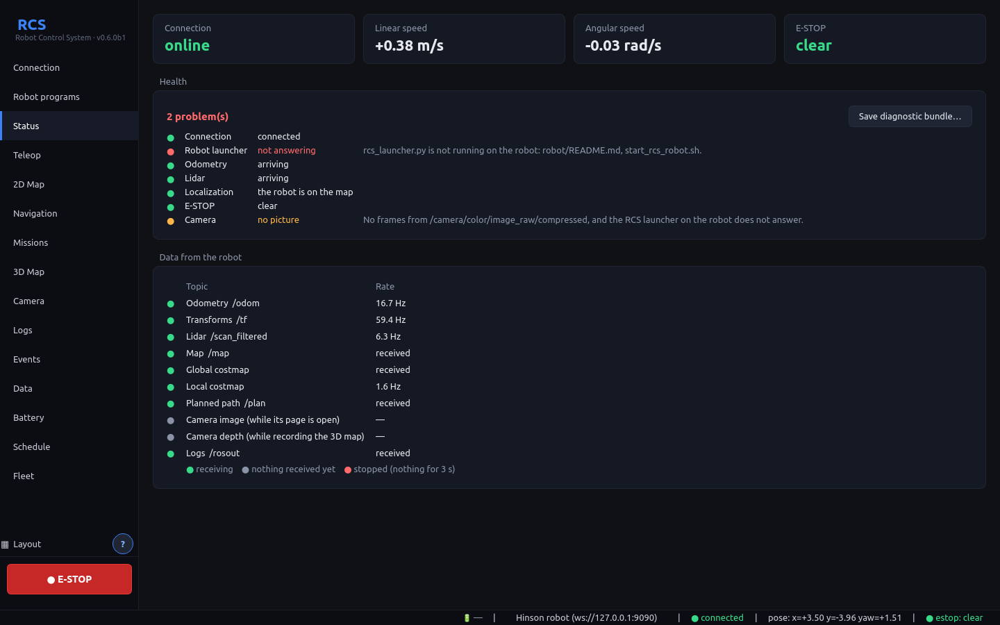

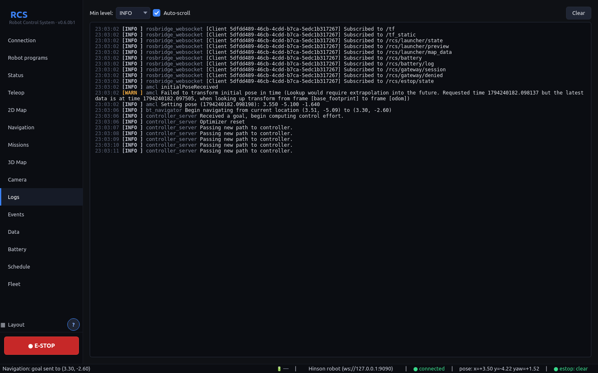

- **Status:** connection, linear and angular speed (from `/odom`), E-STOP
  state, and the message rate of each topic. A rate of `—` means nothing
  is arriving on that topic: check the robot side.
  - **Health**: one line per part of the robot (connection, sign-in, robot
    side version, launcher, base, navigation, odometry, lidar, localization,
    E-STOP, battery, the robot's disk, camera), green, amber or red, with what
    to do when it is not green, and a one-line summary on top.
  - **Save diagnostic bundle…**: one zip to give whoever helps you: the app's
    log, its settings and robot profiles with every password and sign-in token
    taken out, the open robot's events, missions and runs, crash reports, and
    the robot's state as the app sees it now. Nothing is sent anywhere.
  - If the app did not close properly last time (a crash, killed, a power
    cut), the event log says so when it starts. Crash reports are kept with the
    settings (`crashes/`, the last 50).
- **Camera:** live image from `/camera/color/image_raw/compressed` (JPEG),
  limited to about 10 frames/s to spare Wi-Fi. The app only receives it
  while the Camera page is open.
- **Logs:** messages from `/rosout`. Choose a minimum level, toggle
  auto-scroll, or **Clear**. The page keeps the newest 3000 lines.

### 3D Map

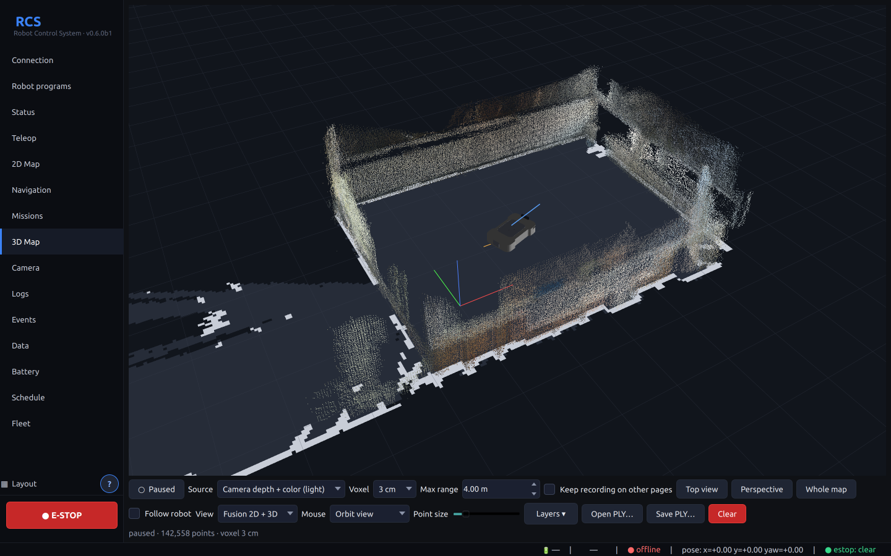

A colored 3D map of what the camera has seen, in the map frame, like the 3D
view of the `report.html` that `save_run` writes after an RTAB-Map run. It
is built in the app while you drive (Teleop or goals):

- Each camera frame (depth + color, about 2 per second) is placed on the map
  with the robot's position **at the moment the frame was taken**, so the
  map stays straight while the robot turns. Everything is merged into a grid
  of small cubes (the **Voxel** size, 3 cm by default): one colored point per
  cube.
- **● Record 3D map** adds to the map. With **Record on every page** (on by
  default, remembered) it keeps growing whatever page is open: it uses about
  1 MB/s of Wi-Fi all the time. Untick it to record only while this page is
  open. The map is kept until you click **Clear** or close the app.
- **Source:** *Camera depth + color* (default, light) uses
  `/camera/depth/image_raw/compressedDepth` + the color image + the depth
  `camera_info`. *PointCloud2 topic* uses the topic set on the Connection
  page (default `/camera/depth_registered/points`, much heavier). A
  PointCloud2 that is already in the `map` frame (e.g. an RTAB-Map cloud
  map) replaces the whole map instead of adding to it.
- **Max range:** depth farther than this (4 m by default) is too noisy to
  keep.
- **Save PLY… / Open PLY…:** save the map as a `.ply` file (opens in
  CloudCompare / MeshLab), or open one. Opening also works with the
  `map/cloud3d.ply` of a `save_run` result folder, to look at an RTAB-Map run
  in the app. Opening a file pauses recording so the live camera does not
  add to it; click **Record** to continue.
- View: **left-drag** orbits, **right-drag** (or Shift+left-drag) pans,
  **wheel** zooms. **Top view**, **Perspective** and **Whole map** set the
  camera; **Follow robot** keeps the robot in the middle (panning turns it
  off). **Point size** changes the dot size.
- **View** picks what is drawn: **Fusion 2D + 3D** (default) shows the 3D map
  together with the 2D map on the floor and the live lidar, planned path,
  local costmap, goal and mission waypoints, **3D map only** hides the 2D
  layers, **2D layers only** hides the 3D map and looks from above.
  **Layers ▾** switches each layer on or off one by one (also the global
  costmap, robot, trajectory and grid). These layers use the data the 2D
  pages already receive, so they cost no extra Wi-Fi.
- **Mouse** chooses what a left press-and-drag does: **Orbit view**, or
  **Set goal**, **Set initial pose**, **Add waypoint**: press on the floor
  and drag toward the heading, like on the 2D Map (right-click cancels).

The page needs OpenGL; on PCs without it the page shows a notice.

---

### Events

What happened and when: connection lost and back, E-STOP, goals sent, reached
or aborted, missions (started, each arrival, retries, stopped, complete),
robot programs started, stopped or failed with the reason, and odometry or
lidar that stopped arriving. Errors are red and warnings amber, the newest on
top. Filter by level or source; **Export CSV…** saves what is shown, for
looking at a run later.

With **Sound alerts** on (the default), the PC plays a sound on errors and
warnings. The sidebar counts new warnings and errors (**Events (2)**) until you open the
page, and the newest event also shows for a few seconds at the bottom left.
The last 2000 events of each robot are kept in its `events.csv`, so they are
still there after a restart.

The 3D Map draws the robot from its model (Connection page, **Robot model**):
the Hinson AMR from its CAD files, drive wheels in their wells and the camera
included, or a model you imported. A robot without one gets a plain box of its
footprint.

### Going to charge by itself

On the Battery page, **Charging**: tick **Go to charge by itself**, set the
charge to go below (25% by default) and to go back to work above (90%), and
choose a saved place in front of the charger (Navigation page, saved places).
Below the charge, a running mission pauses and the robot drives to that place;
charged again, the mission goes on from the waypoint it was at. The robot has
to charge there by itself (a dock, or someone plugging it in): the page says
whether the battery's current shows it charging. If Nav2 cannot get there, it
tries three times, then says so (an error, also sent by remote alerts). While
the E-STOP is engaged it waits; driving the robot yourself, sending a goal or
starting a mission hands it back to you.

### Remote alerts

**Remote alerts…** on the Events page sends errors (and, ticked, warnings) of
the event log to Telegram and/or e-mail, from this PC while RCS runs: E-STOP,
a robot that stopped itself, a failed mission, the link lost, low battery.
The same event goes out at most once every 10 minutes, and at most 20
messages an hour. **Send a test message** checks the settings; a message
that cannot be sent is noted in the event log.

- Telegram: create a bot with @BotFather, paste its token, and the id of the
  chat or group it should write to (send the bot a message first).
- E-mail: your mail server (for Gmail: `smtp.gmail.com`, port 587, STARTTLS,
  an app password), and the address(es) to send to.

### Battery

The robot reads its JK-BMS over Bluetooth and sends the values to the app, so
you can watch the battery from anywhere on the network. The status bar shows the
charge; the **Battery** page shows voltage, current, temperatures, every cell and
how the link is doing. Numbers from a lost link stay on the page in grey with
their age. Events get a warning at 20% and an error at 10%.

The robot connects by itself and keeps trying for as long as it takes. The BMS
accepts one connection at a time: while a phone is connected to it the robot
cannot get in, and once the robot is in, the phone cannot. The app only reads;
nothing it does can change a setting of the BMS.

If the page says the robot's Bluetooth hears no device at all, check its antenna,
or fit a USB Bluetooth adapter near the battery (`robot/README.md`).

**Now** shows everything the BMS reports: each cell with its resistance, the
average cell, balancing, total Ah discharged, how long the BMS has been
running, and alarm bits if any are set. Above it, a warning when the robot's
last boot **ended without a clean stop** (a power cut or a crash), with the
battery's last values before it, and when the robot's disk is getting full.

**History** is the robot's battery log: one file per time the robot was
switched on, one row every second, written to its disk at once, so the last
seconds before a power cut are in it.

- **Boot:** pick one boot to see it over time, or **All boots: trend** for a
  point per boot (lowest charge, lowest voltage, largest cell difference,
  hottest…), to see the battery age over weeks.
- The buttons pick what the chart shows: charge, voltage, current, cell
  difference, temperature, MOS temperature. One measure at a time. Hover for
  the value at a time. Gaps are times the BMS was not heard.
- The table lists every boot: when, how long, charge from → to, lowest
  voltage, largest cell difference, hottest, reconnects, and **how it
  ended** (shut down, or power cut / crash at what time with what battery).
  Double-click a row to open it.
- The running boot follows on its own while the page is open.
- Boots are copied to this PC as you open them and stay there, so they can
  be looked at without the robot.
- **Nothing is deleted by itself**, on the robot or on this PC. **Delete
  this boot's log…** deletes one boot, on both, after you confirm. The running
  boot cannot be deleted.

The files themselves are plain CSV, in `~/tbm_test/battery_log/` on the robot
and in the robot's folder on this PC (Data page shows where); every column is
described in `robot/README.md`.

---

## 13. Schedule: missions at set times

The **Schedule** page starts missions by themselves.

1. **Add…**: pick the mission, the time, the days, and the least battery
   charge it needs (0 = do not check). **On / off** pauses a schedule.
2. At that time, if the robot is ready, the mission starts from its first
   waypoint, exactly as **Start** would.

The robot is ready when: the app is open and connected to that robot,
navigation is running, E-STOP is off, no other mission runs, the battery is
known and at least the charge asked for, and the mission is for the map Nav2
runs on. Otherwise the run is **skipped**, and the report says why.

- Schedules run **only while this app is open** and connected: the missions
  are driven from the app. A time that passed while the app was closed, or
  while the PC was asleep, is not made up for later.
- Times are this PC's local time. Each robot has its own schedules.

**Run reports** lists every run, by hand or by the schedule: when, which
mission, who started it, the result (complete, stopped, failed, skipped,
interrupted), how long, waypoints reached, laps, retries, distance driven,
battery before → after, and why it ended. Select one to see what happened
during it, step by step. **Export CSV…** saves them all. Reports are kept
until you delete the file; a run cut short by a crash of the app shows as
*interrupted*.

---

### Statistics

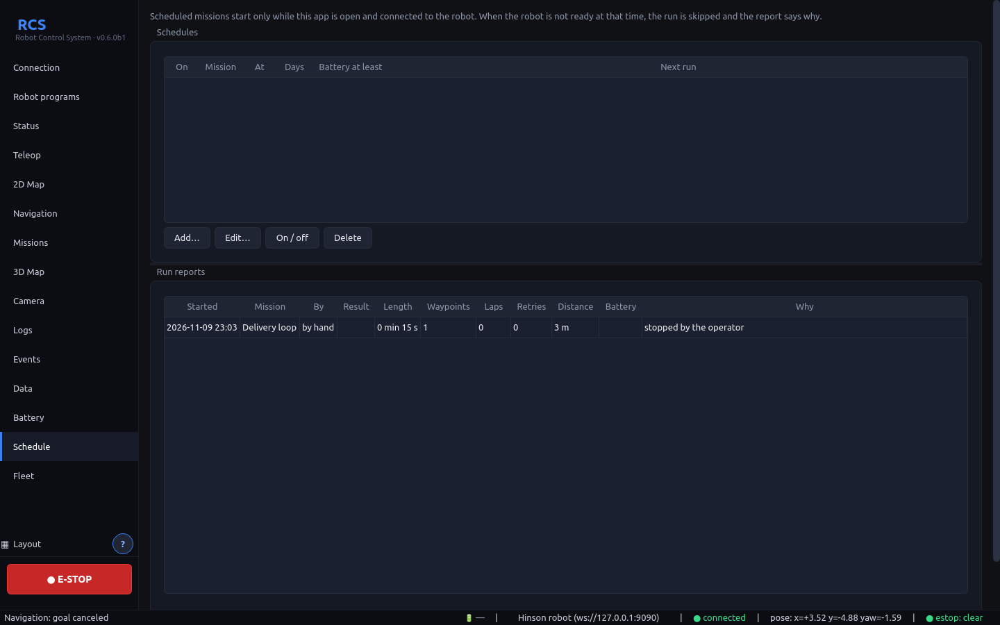

At the bottom of the Schedule page, **Statistics** sums up a period (today, 7,
30 or 365 days) from the run reports and the event log: missions run and how
they ended (success rate over the runs tried), distance, time at work,
waypoints reached, retries, battery used, E-STOPs, stops for a lost app, trips
to charge, errors and warnings, per mission and per day, and why runs were
skipped. **Save PDF…** writes it as a one-page report.

## 14. Several robots

Each robot is a profile on the **Connection** page.

1. Click **+ Add**, then fill in its name, host and topics. Click **Save
   changes**.
2. To switch robots: select it in the list and click **Connect**.

The app controls **one robot at a time**. Each robot has its own missions,
saved places and event log on this PC, and the app remembers how you left it:
layout, open mission, saved map or SLAM, last position on each map.

- Selecting a robot in the list opens its data. While connected the app stays
  on the connected robot, whatever you select; it follows your selection once
  you disconnect.
- A robot's layout comes back when you connect to it.
- Switching to another robot stops a running mission.
- If the app closed during a mission, the Missions page shows where it was and
  selects that waypoint. **Nothing starts by itself:** check that the way is
  clear, then click **Start from selected waypoint**. A looping mission goes on
  with the lap it was on.

Removing a robot from the list leaves its data on the disk.

### Fleet page: watch them all

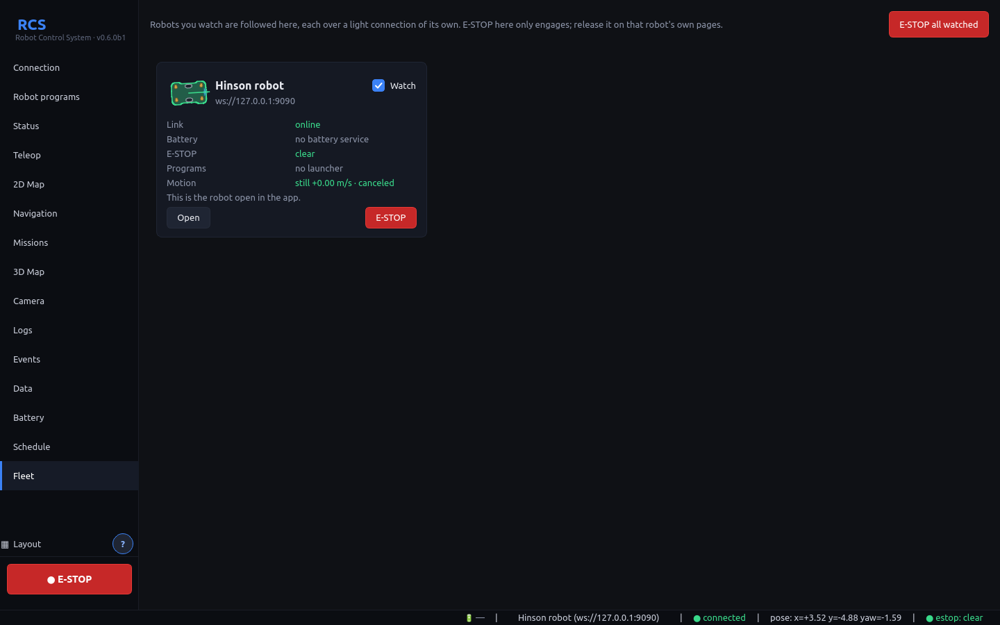

The **Fleet** page shows every robot of the list as a card. Tick **Watch** on
the ones to follow (remembered). Each watched robot gets a light connection of
its own: battery, programs, E-STOP, speed and Nav2's state, no maps or camera,
so watching many costs little. The robot you drive keeps its full connection.

Each card shows the robot from above, from its own model, turned the way it
faces (on the map when AMCL runs, otherwise by its odometry; the tooltip says
which) and coloured by how it is: green fine, amber something to look at, red
offline or E-STOP, grey not watched. An arrow shows when it drives forward or
back.

- **Open** connects the app to that robot to drive it.
- **E-STOP** on a card, or **E-STOP all watched**, engages the E-STOP of those
  robots. It only engages: release it on that robot's own pages, once you know
  it is safe. The result line says which robots it reached; a robot that is
  offline cannot be reached.
- A card also says when the robot last stopped itself because it lost an app.

**After updating from v0.5.0-beta.1 or older:** your missions and places are
copied to every robot, because the old list does not say which robot each one
was for. Delete what does not belong. The old files stay as `*.migrated`.

---

## 15. Back up, share and copy maps (Data page)

**Back up…** saves everything about the open robot in one `.rcspack` file.
**Share…** starts with only what is useful to someone else: missions, places
and the maps they use. Tick or untick what goes in the file, then send it any
way you like: a shared folder, a USB stick, a chat.

**Import…** shows what is in a file and lets you choose what to take:

- **Add to** the open robot, or **As a new robot** if the file has a robot
  profile. The new robot appears on the Connection page; nothing else changes.
- Importing only adds. A mission or place you already have is skipped; one with
  the same name but different content is added as *name (2)*. A different map
  with a name already in use is kept as *name_2*, and the missions from the file
  follow it.
- Importing into a robot is refused while its mission runs.
- Speed limits in a file are held to what the Connection page allows. **Check
  them before driving a robot you imported.**
- A robot's imported model goes in its backups and, ticked, in what you share.
  Imported, it is used unless the robot has an imported model already.

**Maps.** Maps on this PC are shared by all robots. To give a map to another
robot: select it under *Maps on the robot*, **Copy to this PC**, connect to the
other robot, select it under *Maps on this PC*, **Send to robot**. To give it to
another person, include it when you click **Share…**.

- Sending a map with a name the robot already has asks first, and the map Nav2
  is running on cannot be replaced.
- A map works only where it was made. Two robots can use one map, but each still
  needs its initial pose.
- Only `.pgm` maps can be copied, which is what **Save map** writes.
- Needs `rcs_launcher.py`, `map_exchange.py` and `map_files.py` updated on the
  robot; the page says so otherwise.

**A mission belongs to its map.** It remembers the saved map its first waypoint
was set on (shown under its name) and will not start while Nav2 runs on another
one. In SLAM mode, with Nav2 started outside the app, or for a mission made
before this version, there is no map to compare: check it yourself.

---

## 16. Settings files and advanced options

| | Linux | Windows |
|---|---|---|
| Robots | `~/.config/RCS/robots.json` | `%APPDATA%\RCS\robots.json` |
| One robot's data (missions, places, events, last state) | `~/.config/RCS/robots/<id>/` | `%APPDATA%\RCS\robots\<id>\` |
| Maps on this PC | `~/.config/RCS/maps/` | `%APPDATA%\RCS\maps\` |
| App log | `/tmp/rcs.log` | `%TEMP%\rcs.log` |

Some per-robot options are only in `robots.json` (edit while the app is
closed):

| Key | Default | Meaning |
|---|---|---|
| `limits.footprint_half_length` / `_half_width` | 0.45 / 0.30 m | footprint (also on the Connection page) |
| `model` | `auto` | `auto`, `hinson`, `box` or `imported` (Connection page, Robot model) |
| `limits.laser_offset_x` | 0.40 m | lidar position, used only if `/tf_static` has no `laser_frame` |
| `limits.image_throttle_ms` | 100 | minimum time between camera frames |
| `limits.cloud_throttle_ms` | 500 | minimum time between depth frames / point clouds for the 3D map |
| `topics.*` | see section 1 | every topic and frame name |

**Command-line options**

```
rcs --host 192.168.10.10:9090 --autoconnect
```

- `--host HOST:PORT` sets the active robot's address.
- `--autoconnect` connects on start.

---

## 17. Troubleshooting

**No picture on Camera or 3D Map**

The Camera page says why in amber above the picture; 3D Map says it in its
status line. Most often:

- *The robot sees the color camera but not its depth sensor on USB.* The depth
  half of the Astra+ sometimes does not come up when the robot boots, and the
  driver then waits without an error while Robot base still shows *running*.
  Unplug the camera and plug it back in: software cannot do this for you, the
  robot's USB ports stay powered, and rebooting rarely helps. It goes wrong when
  the camera tries USB 3 over a bad link, so if it keeps happening connect it
  through a USB 2.0 cable (the camera runs at USB 2 speed anyway) or another port.
- *The camera is off.* Start Robot base.

3D Map works with Robot base alone, in odometry, and starts again when Nav2 or
SLAM brings a map.

**Cannot connect / keeps reconnecting**
- Is rosbridge running on the robot? From the operator PC,
  `curl -i http://<robot-ip>:9090` should answer (any HTTP reply, e.g.
  `400` or `426`, means it is up). A timeout means it is not running or a
  firewall blocks it.
- Is the host/port right on the Connection page? Did you click **Save
  changes**?

**Robot programs page says "The robot does not answer"**
- The RCS launcher is not running on the robot. Install it (section 2). Its
  log is `~/tbm_test/runlog/rcs_launcher.log` on the robot.

**Bringup or navigation shows "failed"**
- Open **Show log** on that stack: the last lines usually name the problem
  (lidar not reachable, motor driver USB adapter missing, map file not found).
- Fix it and click **Start** again.

**Connected, but no map, scan or pose**
- Is bringup running? See the **Robot programs** page.
- Open **Status**: topics with `—` are not arriving.
- rosbridge must run with the same DDS settings as the robot stack
  (section 2). Restart it from a shell where `ros2 topic list` shows the
  robot topics.
- The topic names on the Connection page must match the robot.

**Lidar points do not match the walls**
- The robot is not localized: use **Set initial pose** (section 9).

**Goal shows "no response from Nav2"**
- Start navigation on the **Robot programs** page. With a saved map, set the
  initial pose: Nav2 only finishes starting once AMCL has a pose.

**The robot reaches the goal but faces the wrong way**
- In Nav2's planner settings (`nav2_smac_mppi.yml`, `GridBased`),
  `use_final_approach_orientation` must be `false`. With `true` the planner
  replaces the heading you clicked with the direction it arrives from. This
  workspace ships with `false`.

**Goal stays on "navigating" near the goal, robot shuffles or spins**
- Nav2 cannot close the last few centimetres to the side. The
  workspace uses `xy_goal_tolerance: 0.15` and starts turning to the goal
  heading 0.35 m before the goal (`GoalAngleCritic.threshold_to_consider`),
  which avoids it. Cancel the goal and send it again if it happens.

**Robot does not move with Teleop**
- The driver must listen on `/cmd_vel_safe` (this is the bringup default).
  If bringup was started with `cmd_vel_topic:=/cmd_vel`, change **cmd_vel**
  on the Connection page to `/cmd_vel`.
- Check the E-STOP is released (status bar).

**Camera page stays black**
- The camera is only received while the Camera page is open: give it a
  second after opening the page.
- Install `ros-humble-compressed-image-transport` on the robot and check
  that `/camera/color/image_raw/compressed` exists.

**The app shows "Not Responding" or stops updating**
- Fixed in v0.4.0: older versions froze the window for 10 s every time they
  tried to (re)connect to a robot that did not answer, e.g. after a Wi-Fi
  drop. Update the app.
- After a Wi-Fi drop the app reconnects by itself within a few seconds; the
  status bar shows *offline* meanwhile. Commands are not queued while
  offline: nothing old is sent to the robot when the link comes back.

**3D Map stays empty ("no camera frames")**
- Bringup must be running (the camera is part of it).
- With the default source, the robot needs
  `ros-humble-compressed-depth-image-transport` (section 2). Check
  `ros2 topic list | grep compressedDepth` on the robot. Or switch **Source**
  to *PointCloud2 topic*.
- "no TF from map to …": navigation (SLAM or AMCL) is not running, so there
  is no `map` frame yet.

**The 3D map is smeared or doubled**
- The robot was not localized while recording (AMCL jumped). **Clear** the
  map, set the initial pose, and record again.

**The app closes unexpectedly**
- Look at the app log (section 14): crashes, including hard ones inside
  Qt or OpenGL, leave a stack trace there. The console build on Windows
  shows the same output live.
